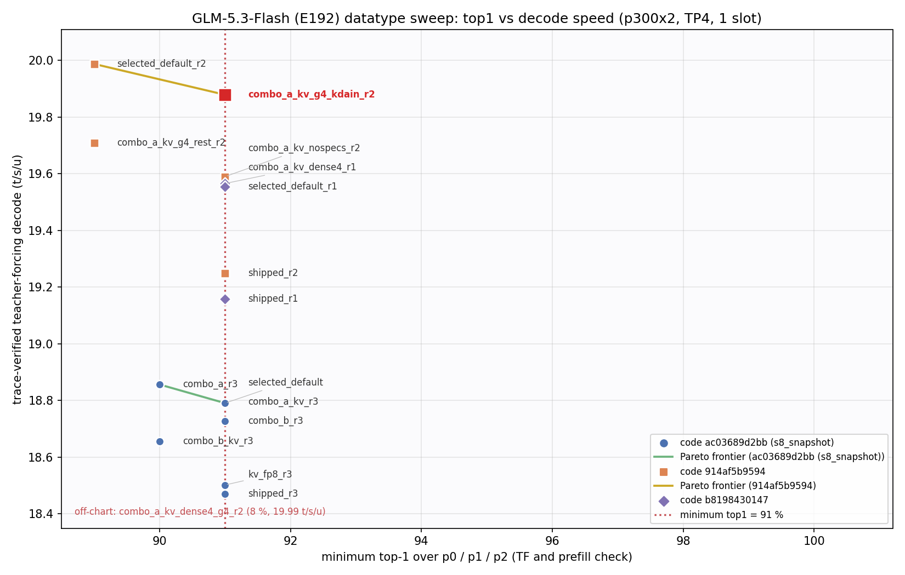
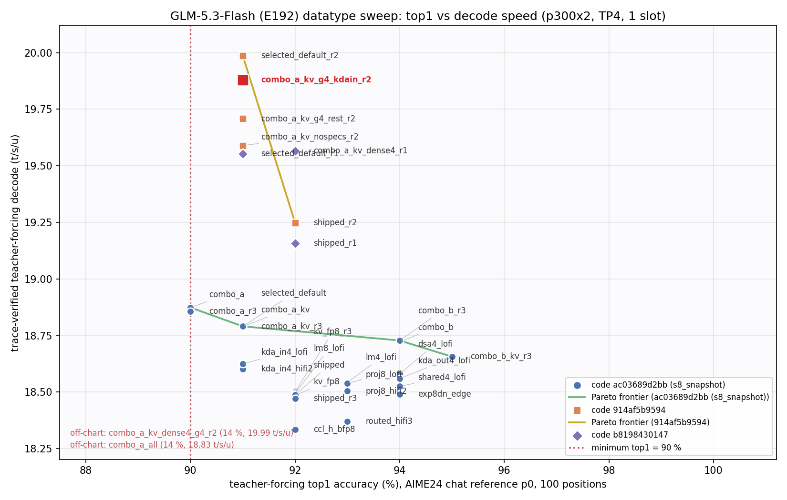
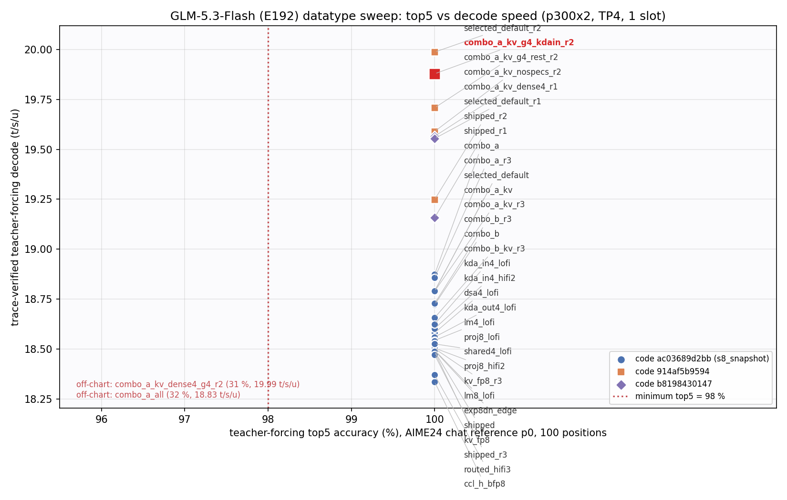

# GLM-5.3-Flash (E192) datatype sweep

Stage 8 of the tt-model-bringup flow. The model is the full 45-layer model (`tt/model.py`, `tt/generator.py`) on a
p300x2 (4 Blackhole dies, mesh (1, 4), FABRIC_1D, TP4). The sweep selects the weight, fidelity, CCL and KV-cache
datatypes of the optimized full model (stage 7).

## Result

**Selected: `combo_a_kv` + the bfp4-tuned KDA input-projection program** (`selected_precision_config.json`, measured as
`configs/combo_a_kv_g4_kdain.json`). It is the stage-7 policy plus these changes:

| Group | Stage 7 (`GLM53_PRECISION=none`) | Selected (default) |
|---|---|---|
| KDA input / output projections, layers 1-43 | bfp8, HiFi4 | **bfp4, LoFi** (decode rows) |
| DSA q_a \| kv_a pack, q_b, o_proj (all 11 DSA layers) | bfp8, HiFi4 | **bfp4, LoFi** (decode rows) |
| Shared expert, layers 3-43 | bfp8, HiFi4 | **bfp4, LoFi** |
| LM head | bfp8, HiFi2 | **bfp4, LoFi** |
| KDA projections of layers 0 and 44, shared expert of layer 44, dense MLP (layers 0-2) | bfp8, HiFi4 | bfp8, **LoFi** (decode rows) |
| DSA latent pool (KV cache) | bf16 rows | **fp8 e4m3 rows** |
| KDA input projection decode program, layers 1-43 | ttnn default | **`1d:c29:ib4`** (`decode_specs`) |
| Routed experts, router, DSA W_UK / W_UV, indexer, residual, CCL, norms, mHC | unchanged | unchanged |

The DSA cache drops from 11,968 to 6,336 bytes per token per die.

**Headline: the post-selection gate on HEAD (914af5b9594).** HEAD differs from the code gated in review #1
(b8198430147): the stage-5 review-#3 commit 8e9efeb7dd7 added `dsa_q_mm_ib=64`, the build-time shared-tail buffer and a
q_rm lifetime fix. The gate ran on `~/glm53-flash-bringup/s8r2b_snapshot` = `git archive 914af5b9594 models/` + the
review-#2 edits (`tt/precision.py`, the stage-8 tools, the configs). Only `tt/precision.py` differs from the commit
among the `tt/*.py` (record `code`). The stage-7 policy ran on the same code as `GLM53_PRECISION=none`.

| Metric (1 slot, max_seq_len 16,384, TP4) | Stage-7 policy (`shipped_r2`) | combo_a_kv, no decode programs (`combo_a_kv_nospecs_r2`) | **Selected (`combo_a_kv_g4_kdain_r2`)** |
|---|---|---|---|
| Teacher forcing top-1 p0 / p1 / p2 (top-5, top-100: 100 %) | 92 / 98 / 91 % | 91 / 96 / 91 % | **91 / 96 / 91 %** |
| Prefill check top-1 p0 / p1 / p2 (top-5, top-100: 100 %) | 91 / 97 / 91 % | 91 / 95 / 91 % | **91 / 95 / 91 %** |
| Trace replays during teacher forcing | 198 (= 2 x 99 decode steps) | 198 | 198 |
| Token-out decode (model + sampler trace, device feedback, no readback, 30 replays) | 51.96 ms = 19.25 t/s/u | 51.06 ms (-1.7 %) | **50.38 ms = 19.85 t/s/u (-3.0 %)** |
| Trace-verified teacher-forcing decode (readiness runner, 1 readback per step) | 19.25 t/s/u | 19.59 t/s/u | **19.88 t/s/u** |
| Generate loop, one token readback per step | 52.07 ms | 51.19 ms | 50.50 ms |
| TTFT, warm, device logits: 128 / 161 / 2048 tokens | 230 / 376 / 1033 ms | 228 / 374 / 1026 ms | same program as no-specs (decode-only change) |
| Non-aligned prompts (100 / 161 / 300 tokens): traced vs eager, repeated | - | - | equal |
| Model weight load, warm cache | 95.6 s | 103.8 s | 89.4 s |
| 1-slot context (max_model_len) | 104,448 (stage-6 probe) | 311,296 | **311,296** (measured, below) |

- Load times vary by about +-10 s between builds of the same weights. The cold precision cache (first load after the
  key change) took 147.8 s (`runs/selected_default_r1`).
- The review-#1 gate on b8198430147 (`runs/selected_default_r1`, `runs/shipped_r1`) gave the same accuracy and
  51.14 vs 52.20 ms.

The qualitative and autoregressive checks ran on two builds of the default:
- `runs/selected_default_r1/checks/` (b8198430147, no decode programs);
- `runs/selected_default_r2/checks/` (HEAD, all bfp4-tuned programs, not adopted).
The final config (kda_in program only) had no separate qualitative run. Its teacher-forcing results equal the
no-specs build on all three references.
- **Qualitative suite**: 6 chat prompts. 5 end on EOS. q3 reaches the 2,048-token budget, as in stage 7.
  - The texts are coherent and on topic.
  - q5 leaves "Bonjour, how are you today?" untranslated. The HF control does the same (doc/full_model/qualitative/VERDICT.md).
- **Autoregressive check**: two runs bit-identical, `check_degenerate_output` exit 0 (adjacent duplication 0.0).
  - Its own HF control: `tools/hf_full_ref.py --mode score-trajectory` over the r1 trajectory
    (`runs/selected_default_r1/checks/autoregressive/hf_scores_tt_trajectory.json`, CPU).
  - HF top-1 agreement is 93.75 % and top-5 is 100 % over 256 tokens; the worst TT pick is HF's rank 5 (token 53).
  - TT leaves HF's greedy path at token 0. TT picks " something", HF's rank-2 token, 0.375 logits below " a" in HF's
    teacher-forced pass (0.625 in HF's incremental decode, doc/full_model/autoregressive/VERDICT.md).

**Acceptance gate** (skill default): teacher-forcing top-1 >= 90 %, top-5 >= 98 % and top-100 = 100 %. The prefill
check must meet the same values (`tools/dtype_sweep_report.py` applies all six).

**Selection rule** (coordinator, on top of the gate):
1. The minimum top-1 over teacher forcing and prefill check on three AIME24 chat references must be >= 91 %.
   The references are p0 (the readiness reference), p1 and p2. Top-5 and top-100 must hold on all three.
2. Among the configs that pass, prefer context, then decode speed.
3. A context gain below ~5 % that is only estimated (unmeasured) does not override a config with fewer bfp4 groups
   at equal speed. This rule was added after `combo_a_kv_dense4` was measured (review #1). It decided only that case.

The charts plot trace-verified teacher-forcing decode t/s/u (readiness runner) on y. Red = selected; the dotted line
is the gate.
- `min_top1_perf.png`: x = the minimum top-1 over p0 / p1 / p2. Only three-reference runs are points. The line is at 91 %.
- `top1_perf_pareto.png` and `top5_perf_pareto.png`: x = accuracy on p0. Every evaluated full-model run is a point.
- On the top-5 chart every point except `combo_a_all` ties at 100 %. So the frontier is the single fastest point.
- Points from three code generations appear (Method), with one marker and one frontier per generation. Compare speeds
  only within one generation:
  - `_r2` runs: HEAD 914af5b9594.
  - `_r1` runs: commit b8198430147. They are about 2 ms per step faster than s8_snapshot from the stage-5 defaults.
  - All other runs: s8_snapshot (ac03689d2bb).

## Method

### Code under test

| Snapshot | Content | Used for |
|---|---|---|
| `~/glm53-flash-bringup/s8_snapshot` | `git archive ac03689d2bb models/` + the stage-8 files: `tt/precision.py`, the fp8 pool in `tt/dsa.py`, the hooks in `tt/model.py` and `tt/multichip_decoder.py`, `tt/dsa_shard.py` fp8 sizing (`dsa_bytes_per_token`), `tools/dtype_sweep*.py`, `tools/kv_fp8_probe.py`, `tools/long_ctx_*.py`; `tools/memory_probe.py` patched to load the weight cache (`weight_cache="env"`) | the 18-candidate sweep, the three-reference finalists, the first capacity probe, the long-context check |
| `~/glm53-flash-bringup/s8_snapshot2` | s8_snapshot + the then-current stage-6/7 rework files `tt/{dsa, dsa_shard, decode_inputs, functional_decoder, generator, generator_vllm, model, weight_cache, serving_state}.py`, `tt/e192_mask.json`, `tools/{memory_probe, readiness}.py`; dsa_shard.py md5 changed (fp8 sizing line re-added) | the combo_a_all rerun that crashed (below) |
| `~/glm53-flash-bringup/s8_snapshot_flip` | s8_snapshot + the default flip in `tt/precision.py`, the `root_cache` hook, `tests/test_precision_host.py` | the first post-selection runs (`runs/selected_default*`, superseded by `_r1`) |
| `~/glm53-flash-bringup/s8r1_snapshot` | `git archive b8198430147 models/` + the review-#1 `tt/precision.py`, `tools/dtype_sweep.py`, `tools/long_ctx_check.py`, `tests/test_precision_host.py`, `configs/combo_a_kv_dense4.json`; `tools/memory_probe.py` patched to `weight_cache="env"` | the review-#1 gate (`_r1`), the 337,920 / 1,024 MiB capacity probe |
| `~/glm53-flash-bringup/s8r2_snapshot` | `git archive 914af5b9594 models/` + the review-#2 `tt/precision.py`, `tools/{mc_matmul_sweep, dtype_sweep, dtype_sweep_report, long_ctx_check}.py`, `tests/test_precision_host.py`; `tools/memory_probe.py` patched to `weight_cache="env"` | ticket A: the bfp4 geometry sweep, the fp8 profile, the 337,920 / 832 MiB capacity step |
| `~/glm53-flash-bringup/s8r2b_snapshot` | s8r2_snapshot + the LM-head decode-program hook in `tt/precision.py`, `tools/dtype_geometry_summary.py`, the `*_g4*` configs | tickets B and C: the HEAD gate (`_r2`), the program bisect, the 337,920 MoE-split step |

Every job after the first baseline ran with its working directory inside its snapshot. `python -m` puts the working
directory before PYTHONPATH. One early baseline ran from the live tree by mistake (6 / 28 / 99 %); it was discarded
(`logs/s8/shipped_LEAKED_livetree.log`).

What each record holds:
- The md5 of each `tt/*.py` (`code.md5`): every `tools/dtype_sweep.py` run from the code pinning on.
- The digest of that md5 map, the base commit, the real argv, the GLM53_* / MESH environment and the calling script:
  the review-#1 and review-#2 runs (`_r1`, `_r2`) only.
- Older rows in `sweep_results.*` mark their command and script as `[reconstructed]`.
- The long-context records (`long_context/*.json`) predate both. They record the indexer block size
  (`GLM53_DSA_INDEX_BLOCK_MB`: 32 MB for shipped, 64 MB default for combo_a_kv) but no md5 map.
- The capacity probes have a sidecar `provenance.json` with the md5 map, from the 337,920 probes on. The first
  probe (`capacity/combo_a_kv_s1`) has none. Kernels and the ttnn build always come from
the repo. The live mhc_split_sinkhorn kernel diff against HEAD at the time was inert: only `#ifdef SK_FACES` paths,
which no stage-8 job enabled.

### Candidates

`tt/precision.py` (`PrecisionOverrides`) applies a policy JSON at construction. There are two hooks:
`MultichipDecoder.from_state_dict` (per layer) and `Glm53Model.__init__` (LM head). The JSON fields:
- `requant`: host round-to-nearest re-quantization of a group's loaded bfp8 tensors to bfp4, per die, with the same
  memory config. The rounding from bfp8 equals the rounding from bf16, except at ties of the bfp8 grid. The device
  typecast is not used: it does not round to nearest (stage 3).
- `fidelity`: the compute fidelity of a group's decode-row matmuls (KDA, DSA projections, dense MLP, LM head). For the
  shared expert and the routed experts it covers all rows (the MoE `shared_fidelity` / `routed_fidelity` fields).
- `moe_layer_exceptions`: per-layer MoE fields. A layer with a dtype exception is built from the checkpoint. Its
  re-quantized tensors are not cached either.
- `ccl_h_dtype`: the decode all-gathers of the residual in bfp8 (cast before, cast back after).
- `kv_latent_dtype`: the DSA latent pool in fp8 e4m3 rows.
- `decode_specs`: per-layer MCOpts decode-program specs (and `lm_head`) on the layers where a group is bfp4. DEFAULT_MC
  itself is unchanged.

`GLM53_PRECISION` selects the policy:
- unset or empty: `selected_precision_config.json` (the default);
- `none`, `shipped`, `off` or `0`: the stage-7 policy;
- `<json>`: a candidate.

No candidate needs its own 116 GB weight cache. Every build loads the shipped-policy cache and changes only the
overridden groups.

### Re-quantized tensor cache

A warm load must not re-quantize. `PrecisionOverrides._rq` stores each re-quantized tensor in the weight cache at
`<root>/<layer_i | top>/prec-<requant source digest>/<group>-<dtype>-<digest>.tensorbin`. The final digest covers:
- the owning component's source digest (`weight_cache.component_digest`: kda / dsa / mlp / moe / top). For the DSA
  q_a|kv_a pack it also covers `MultichipDSA._build_pack`, `DSMatmul`, `IL1DMatmul` and `make_role_mm`. The
  ImportError fallback (host tests) is logged and named `nodigest`;
- the source tensor's memory config, padded shape and dtype.

On a cache hit the loaded tensor's memory config, padded shape and dtype are checked against the source tensor. A
mismatch rebuilds the file. The default and an explicit `GLM53_PRECISION=<selected file>` resolve the same files.

### Propagation check

- `runtime_policy`: dtypes and compute fidelities read back from the live model objects.
- `precision.applied`: every change, per layer.
- `fidelity_seen_one_eager_step`: the fidelity the wrappers passed to each decode matmul group in one eager decode
  step. On HEAD it is kda_in LoFi x 34, kda_out LoFi x 34, DSA q_a|kv_a / q_b LoFi x 33, DSA o_proj LoFi x 11,
  dense MLP LoFi x 3. This is every layer of each group (`runs/combo_a_kv_g4_kdain_r2/record.json`).
- The wrappers keep each module's own `fp32_dest_acc_en`, `packer_l1_acc` and approx mode, and change only the
  fidelity (review #2). Before that, the LM head at LoFi had run without packer L1 accumulation. That affects the
  s8_snapshot rows `lm4_lofi` / `lm8_lofi` and the combinations; the `_r2` gate carries the fixed numerics.

### Accuracy and performance

- **Accuracy.** `tools/dtype_sweep.py` builds the generator once per candidate. It runs the readiness runners
  (`run_teacher_forcing`, `run_prefill_check`) on that build.
  - p0 = `readiness_aime24_chat.refpt`: AIME24 prompt 0, chat template, 100 generated tokens, HF CPU reference
    `tools/hf_full_ref.py`.
  - p1 and p2: AIME24 prompts 1 and 2, made with the same tool (`refs/`).
  - Each reference scores 100 positions: the prefill logits give position 0, and 99 traced decode steps give the rest.
- **Trace verification.** The `ttnn.execute_trace` calls during teacher forcing are counted. The count must equal 2 x
  the decode steps (model trace + sampler trace). It is 198 in every run (`trace_verified`).
- **Non-aligned prompts.** Every run prefilled 100-, 161- and 300-token prompts. It compared the traced and eager
  greedy continuations, 8 tokens each, run twice. They were equal and repeatable in every run (`ptcheck`).
- **Performance.** Token-out = 30 back-to-back replays of model trace + sampler trace, with device token feedback and
  no host readback (the stage-7 benchmark). TTFT = warm prefill to device logits, plus a device sync.
- **Context.** The stage-7 1-slot capacity is 818 blocks of 128 tokens at 11,968 B per token per die (stage-6
  probe). For other candidates the report estimates the context from the build's DRAM delta against the shipped build
  of the same code: `floor((818 x 128 x 11,968 - delta) / (128 x bytes per token))`, floored to 2,048.
  - These `~` values are upper bounds. They leave out the DSA constants that grow with max_context, and the larger
    workspace a large pool needs.
  - Example: combo_a_kv was estimated at 364,544 and measured at 311,296. Only the selected policy was measured.

## Candidates and results (s8_snapshot code)

Single changes on the stage-7 policy, one build each, reference p0 (`runs/<id>/`, logs `~/glm53-flash-bringup/logs/s8/`).
"inner" = layers 1-43: the skill excludes the first and the last layer from bfp4 by default.

| id | Change | TF top-1 / 5 / 100 | PC top-1 | Token-out ms | vs shipped | Context | Decision |
|---|---|---|---|---|---|---|---|
| shipped | stage-7 policy | 92 / 100 / 100 | 91 | 54.08 | - | 104,448 | baseline |
| kv_fp8 | DSA latent fp8 e4m3 | 92 / 100 / 100 | 91 | 54.09 | +0.01 | ~196,608 | kept (context x 1.9) |
| kda_in4_lofi | KDA in-proj bfp4, LoFi | 91 / 100 / 100 | 90 | 53.71 | -0.37 | ~149,504 | kept in combo_a |
| kda_in4_hifi2 | KDA in-proj bfp4, HiFi2 | 91 / 100 / 100 | 90 | 53.73 | -0.35 | ~149,504 | rejected: same accuracy as LoFi, slower |
| dsa4_lofi | DSA q_a\|kv_a, q_b, o_proj bfp4, LoFi | 94 / 100 / 100 | 95 | 53.79 | -0.29 | ~118,784 | kept |
| kda_out4_lofi | KDA out-proj bfp4, LoFi | 94 / 100 / 100 | 94 | 53.88 | -0.20 | ~114,688 | kept |
| proj8_lofi | bfp8 projections at LoFi (KDA, DSA, dense MLP decode; shared expert) | 93 / 100 / 100 | 95 | 53.93 | -0.15 | 104,448 | kept (dense MLP, layers 0 and 44) |
| lm4_lofi | LM head bfp4, LoFi | 93 / 100 / 100 | 91 | 53.94 | -0.14 | ~110,592 | kept |
| shared4_lofi | shared expert bfp4, LoFi | 94 / 100 / 100 | 94 | 54.00 | -0.08 | ~114,688 | kept |
| proj8_hifi2 | same groups as proj8_lofi at HiFi2 | 93 / 100 / 100 | 94 | 54.04 | -0.04 | 104,448 | rejected: LoFi is faster at equal accuracy |
| lm8_lofi | LM head bfp8 at LoFi | 92 / 100 / 100 | 91 | 54.09 | +0.01 | 104,448 | rejected: no gain |
| exp8dn_edge | routed down bfp8 (HiFi2) in MoE layers 3 and 44 | 94 / 100 / 100 | 94 | 54.09 | +0.01 | ~69,632 | rejected: -33 % context |
| routed_hifi3 | routed experts bfp4 at HiFi3 | 93 / 100 / 100 | 94 | 54.43 | +0.35 | 104,448 | rejected: slower, no gate need |
| ccl_h_bfp8 | residual all-gathers in bfp8 | 92 / 100 / 100 | 91 | 54.55 | +0.47 | 104,448 | rejected: slower (2 casts per gather; the gathers are latency-bound) |

Combinations (p0). The finalists then ran on p0, p1 and p2 in repeat builds (`runs/<id>_r3/`):

| id | Content | TF top-1 p0 / p1 / p2 | PC top-1 p0 / p1 / p2 | Min top-1 | Token-out ms | Context | Decision |
|---|---|---|---|---|---|---|---|
| combo_a | kda_in4 + kda_out4 + dsa4 + shared4 + lm4 (inner, LoFi) + bfp8 groups at LoFi | 90 / 94 / 91 | 91 / 95 / 91 | 90 | 53.04 | ~192,512 | rejected: min top-1 90 < 91 |
| **combo_a_kv** | combo_a + fp8 latent | **91 / 96 / 91** | **91 / 95 / 91** | **91** | **53.22** | **311,296 (measured)** | **selected** |
| combo_b | combo_a without kda_in4 | 94 / 93 / 92 | 94 / 95 / 91 | 91 | 53.41 | ~147,456 | passes; less context, slower |
| combo_b_kv | combo_b + fp8 latent | 95 / 94 / 90 | 94 / 95 / 91 | 90 | 53.58 | ~278,528 | rejected: min top-1 90 |
| kv_fp8 | (above) | 92 / 97 / 93 | 91 / 97 / 91 | 91 | 54.09 | ~196,608 | passes; slower, less context |
| shipped | (above) | 92 / 98 / 91 | 91 / 97 / 91 | 91 | 54.07 | 104,448 | passes; the slowest but one of the passing set |
| combo_a_all | combo_a on layers 0 and 44 too | **14** / - / - | 90 / - / - | 14 (top-5 32 %) | 53.02 | - | rejected: decode collapse, cause unclassified |

On the committed code (`_r1`, three references):

| id | Content | TF top-1 p0 / p1 / p2 | PC top-1 p0 / p1 / p2 | Min top-1 | Token-out ms | Context | Decision |
|---|---|---|---|---|---|---|---|
| shipped_r1 | stage-7 policy (`GLM53_PRECISION=none`) | 92 / 98 / 91 | 91 / 97 / 91 | 91 | 52.20 | 104,448 | baseline of this code |
| **selected_default_r1** | combo_a_kv (default) | **91 / 96 / 91** | **91 / 95 / 91** | **91** | **51.14** | **311,296** | selected |
| combo_a_kv_dense4_r1 | combo_a_kv + dense MLP bfp4 LoFi on layers 1-2 | 92 / 95 / 92 | 92 / 95 / 91 | 91 | 51.13 | ~+5.8K over combo_a_kv (estimate) | passing alternative, not selected |

- **Noise.** Top-5 and top-100 are 100 % in every finalist cell. Repeat builds of one policy measure the same token-out
  time to 0.02 ms: shipped 54.08 / 54.07, combo_a 53.03 / 53.04, combo_a_kv 53.22 / 53.22 (warm rebuild on the
  committed code: 51.14 / 51.13). So the speed ranking is real.
- **combo_a_kv_dense4.** It passes the rule (review #1, b8198430147) at 51.13 vs 51.14 ms. Its 37 MB per die of freed
  DRAM is ~+5.8K tokens, an estimate. On the same estimate basis (`sweep_results`, upper bounds) dense4 reads 370,688
  against 364,544 for combo_a_kv (+1.7 %); combo_a_kv measured 311,296. That is below the ~5 % bar of rule 3. It is
  recorded, not selected.
  - Stage 3 had rejected dense bfp4 at layer level, but on layer 0 only. Stage 3 also rejected kda_in4 and
    mlp8_lofi, which pass here at model level, so that argument carries little weight.
  - "Equal speed" held without decode programs. With the bfp4-tuned programs, dense4 plus its dense-MLP programs
    (`combo_a_kv_dense4_g4_r2`) collapsed in decode: TF 14 / 8 / 13 %, prefill check 92 / 95 / 91 %. So dense4 was
    not re-decided.
- **fp8 latent inside the combinations.** It costs +0.17 to +0.19 ms per step in the full model (combo_a 53.03 ->
  combo_a_kv 53.22; combo_b 53.41 -> combo_b_kv 53.58), but only +0.01 ms on the stage-7 policy.
  - A Tracy decode window of combo_a vs combo_a_kv on the reduced model (layers 0, 3, 4; `profile/compare_decode.json`;
    per op the maximum device time over the 4 dies) shows +1.5 µs in `sparse_sdpa` and one +1 µs cast per DSA layer.
  - The total device time is 4,114 vs 4,101 µs. About 0.03 ms of the 0.17-0.19 ms is in the fp8 ops; the rest is not
    in the device op time. The cause is not identified.

### combo_a_all: decode collapse, cause unclassified

Extending the bfp4 groups to the first layer (0: KDA + dense MLP) and the last layer (44: KDA + MoE) gave:
- teacher forcing 14 / 32 / 95 %;
- prefill check 90 / 100 / 100 % (one prefill per position: prefill is fine);
- deterministic greedy continuations that collapse into `</think>` (token 154842) loops, equal in eager and traced
  runs and repeatable (`runs/combo_a_all/record.json`, `ptcheck`).

This signature matches two decode-collapse failures that are not precision problems:
- the stage-7 `ag_persistent` failure (TF top-5 32 %);
- the deterministic, layout-dependent decode corruption that the stage-6/7 rework is fixing (the prefill->decode
  hand-off).

So the cause is not classified. combo_a_all is rejected on the measured result. It is to be re-gated after the
stage-6/7 fix. `combo_a_kv_dense4_g4_r2` (above) shows the same signature.

The rerun on the then-current rework code (`s8_snapshot2`, `TT_METAL_TRACE_ALLOC_TRACKING=1`) crashed in the warm-up
prefill inside that code's `tt/dsa.py _set_open_pool` before any measurement (`evidence/combo_a_all_s2trk.excerpt.txt`).
The classification runs wait for the race fix, because before it they would be confounded:
1. a repeat of combo_a_all;
2. bfp4 at HiFi4 decode on layers 0 and 44;
3. layer 0 only;
4. layer 44 only.

## Compute-fidelity table (material decode matmul groups)

| Group | Weight | Fidelity | Token-out ms | TF top-1 (p0) | Kept | Reason |
|---|---|---|---|---|---|---|
| Routed experts | bfp4 | LoFi | 54.08 (shipped) | 92 | yes | HiFi2 is bit-identical on bfp4 weights (stage 3) |
| Routed experts | bfp4 | HiFi3 | 54.43 | 93 | no | +0.35 ms; the gate does not need it |
| KDA in-proj | bfp4 | LoFi | 53.71 | 91 | yes | |
| KDA in-proj | bfp4 | HiFi2 | 53.73 | 91 | no | same accuracy, slower |
| KDA in / out, DSA, dense MLP, shared expert | bfp8 | HiFi4 (shipped) | 54.08 | 92 | no | |
| same | bfp8 | HiFi2 | 54.04 | 93 | no | |
| same | bfp8 | LoFi | 53.93 | 93 | yes | fastest at equal accuracy |
| KDA out, DSA, shared expert, LM head | bfp4 | LoFi | see the table above | 93-94 | yes | |
| LM head | bfp8 | LoFi vs HiFi2 | 54.09 vs 54.08 | 92 | no | no difference |

bfp4 at HiFi2 was compared against bfp4 at LoFi at model level only for the KDA input projection, the largest bfp4
group. For the other bfp4 groups only LoFi was run at model level. The op-level geometry sweep (next section) ran
HiFi2 on each family's best program (`geometry/summary.json`, `hifi2_trials`).

## Decode programs for bfp4 weights

The DEFAULT_MC decode programs were tuned on bfp8 weights in stage 5. The bfp4 groups saved only about 35-40 % of the
bandwidth-bound expectation, so `tools/mc_matmul_sweep.py --wdtype bfp4 --fidelity LoFi --alt-fidelity HiFi2` swept the
decode geometries again on bfp4 weights (one die, 100 traced replays per candidate). It covered in0 blocks 4-64,
1D core counts 16-110, DRAM-sharded activation cores and readers, and the LM head [4096 x 38720].
Results: `geometry/bfp4_lofi_decode.jsonl`, summary `geometry/summary.json` (`tools/dtype_geometry_summary.py`).

| Group | Current program | µs | Fastest buildable within noise | µs | Output vs current | Adopted |
|---|---|---|---|---|---|---|
| kda_in | ttnn default | 151.0 | `1d:c29:ib4` | 74.4 | hash identical | **yes** |
| kda_out | `1d:c16:ib4` | 28.6 | `1d:c16:ib16` | 25.0 | hash identical | no |
| dsa_o | `1d:c16:ib4` | 47.2 | `1d:c16:ib16` | 39.6 | hash identical | no |
| dsa_qb | `1d:c16:ib4` | 23.8 | `1d:c16:ib16` | 21.1 | hash identical | no |
| pack_a (q_a\|kv_a) | `1d:c32:ib8` | 29.5 | `1d:c16:ib32` | 25.3 | hash identical | no |
| shared_gu | `1d:c32:ib16` | 22.8 | `1d:c16:ib64` | 18.7 | hash identical | no |
| shared_dn | `1d:c16:ib4` | 14.4 | `1d:c16:ib16` | 13.3 | hash identical | no |
| mlp_gu (dense4 only) | `1d:c16:ib4` | 61.3 | `1d:c16:ib8` | 55.7 | hash identical | no |
| mlp_dn (dense4 only) | `1d:c16:ib4` | 37.9 | `1d:c16:ib16` | 33.0 | hash identical | no |
| LM head | ttnn default | 355.3 | `1d:c110:ib4` | 330.8 | hash identical | no |

"Buildable" means `make_role_mm` builds the same core count: the 1D core count divides the N tiles. "Within noise"
means the error against fp64 is within 5 % of the current program's error. "Hash identical" means the output's sha256
on the sweep's input equals the current program's.

Model-level gate on HEAD, 3 references (adoption rule (b) of the coordinator):

| Run | Programs | TF top-1 p0 / p1 / p2 | PC top-1 | Token-out |
|---|---|---|---|---|
| combo_a_kv_nospecs_r2 | none | 91 / 96 / 91 | 91 / 95 / 91 | 51.06 ms |
| selected_default_r2 | all | 91 / 96 / **89** | 91 / 95 / 91 | 50.01 ms |
| combo_a_kv_g4_kdain_r2 | kda_in only | **91 / 96 / 91** | **91 / 95 / 91** | **50.38 ms** |
| combo_a_kv_g4_rest_r2 | all but kda_in | 91 / 96 / **89** | 91 / 95 / 91 | 50.77 ms |

- The largest gain (kda_in) passes alone and is adopted.
- The other programs: op-level hash identical, full-model numerics shift (p2 teacher forcing 89 %); not adopted. The
  bisect stopped there (coordinator).
- The op-level hash covers one random input per program. The shift shows that these programs are not equivalent on
  every input.
- The realized kda_in gain is 0.68 ms per step, against about 2.4 ms that the op-level times x 32 layers predict.

## Groups not reduced

- **Router** (bf16, HiFi4): routing numerics. It is not in the bfp4 sweep (skill MoE policy).
- **Dense MLP layer 0** (bfp8): the first layer. Layers 1-2 at bfp4 pass (`combo_a_kv_dense4` above) but are not
  selected.
- **DSA W_UK / W_UV** (bfp8) and the indexer projections (bf16, fp32 output): attention-core numerics and index
  scores, 15 + 35 µs per DSA layer.
- **Routed experts above bfp4**: bfp8 in all layers does not fit in DRAM. `exp8dn_edge` measured the value of a
  partial increase: top-1 +2 points, -33 % context.
- **Residual / activations**: bf16 (the mHC streams). No lower format exists for the residual adds.
- **KV cache in bfp8**: bfp8 is a TILE-only format, but the DSA latent pool is a ROW_MAJOR paged row store
  (`scatter_rows`, `sparse_sdpa`). fp8 e4m3 rows are the supported 1-byte format.
  - `tools/kv_fp8_probe.py` (`evidence/kv_fp8_probe.json`): the device bf16 -> fp8 cast, `scatter_rows` and
    `sparse_sdpa` FP8_E4M3 all work. The attention output PCC is 0.99958 against the bf16 pool.
- **Indexer pool keys in bfp8**: not tried. `ttnn.experimental.dsa_decode_scores` requires bf16 keys
  (`dsa_decode_scores_device_operation.cpp:37`). The saving would be 30 B per token per layer, 5 % of the fp8 cache.

## Long-context check

`tools/long_ctx_check.py` checks the fp8 latent and the bfp4 projections at long range:
- Document: the repository's English documentation, 31 files, frozen token ids `refs/long_doc_ids.json.gz`.
- Both builds see the same positions, at max_seq_len 102,400.
- For L = 2K, 32K and 100K: prefill L - 200 tokens, then run 200 traced decode steps teacher-forced with the
  document's tokens. Read the host logits at every step.

`tools/long_ctx_compare.py` compares the two builds (`long_context/compare_shipped_vs_combo_a_kv.json`):

| L | Shipped true-token top-1 / top-5 | combo_a_kv true-token top-1 / top-5 | Delta top-1 / top-5 | TT-vs-TT top-1 agreement / top-5 overlap | Prefill s (shipped / selected) |
|---|---|---|---|---|---|
| 2,048 | 0.840 / 0.935 | 0.830 / 0.940 | -1.0 / +0.5 pt | 0.930 / 0.843 | 1.2 / 1.0 |
| 32,768 | 0.555 / 0.825 | 0.540 / 0.815 | -1.5 / -1.0 pt | 0.855 / 0.854 | 23.8 / 21.1 |
| 100,000 | 0.700 / 0.895 | 0.695 / 0.875 | -0.5 / -2.0 pt | 0.875 / 0.825 | 73.7 / 65.4 |

The gate (coordinator) allowed no degradation beyond ~3 points against shipped at 32K and 100K. **Result: pass.**
- The deltas stay within 2 points at every length.
- The TT-vs-TT top-5 overlap at 100K equals the overlap at 2K (0.83-0.85).

This check ran on the s8_snapshot code. There is **no accuracy evidence beyond 100K tokens**. The 311K-token capacity
probe below checks function (copy accuracy), not next-token accuracy.

The shipped run needed `GLM53_DSA_INDEX_BLOCK_MB=32` (indexer score blocks; bit-identical, stage 6). With the default
64 MB, the shipped policy at max_seq_len 102,400 ran out of DRAM in the DSA indexer at the 32K prefill
(`evidence/longctx_shipped_try1_oom.excerpt.txt`). The selected policy ran with the default; it has 1 GB more free
DRAM.

## Capacity and context contract

`tools/memory_probe.py capacity` follows the serving path:
1. load the weights and measure free DRAM;
2. size the DSA pool from it;
3. warm up and capture the traced decode;
4. prefill one non-aligned copy prompt that fills the pool;
5. run 24 traced decode steps at the top.

Settings: selected policy, 1 slot, 64 MiB trace region. The probe sizes the pool as
`(free after load - workspace) // bytes per block`, capped at the `--max-context` tokens. A larger step therefore
needs a smaller workspace.

| Step | Code | `--max-context` / workspace | Pool | Result |
|---|---|---|---|---|
| stage 6 (stage-7 policy) | stage 6 | 131,072 / 700 MiB | 818 blocks (free DRAM) | 104,515-token prompt, 170 s, copy 1.0; 183 MB free after the prefill |
| 1 | s8_snapshot | 364,544 / 700 MiB | 2,849 blocks | **out of DRAM** in the warm-up prefill (`evidence/cap_combo_a_kv_s1_try1_oom.excerpt.txt`) |
| 2 | s8_snapshot | 311,296 / 1,024 MiB | 2,433 blocks (free DRAM) | **pass**: 311,235-token prompt, 408.5 s, copy 1.0; 648 MB free after the prefill |
| 3 | b8198430147 | 337,920 / 1,024 MiB | 2,433 blocks (free DRAM) | pass, same pool as step 2 (the larger step was not reached); 836 MB free after the prefill |
| 4 | HEAD | 337,920 / 832 MiB | 2,641 blocks | **out of DRAM** in the warm-up prefill, MoE `_routed_masked` (`evidence/r2_cap_337920.excerpt.txt`) |
| 5 | HEAD | 337,920 / 832 MiB, MoE row split 1,024 | 2,641 blocks | **out of DRAM** in the warm-up prefill, `_routed_sorted_split` (`evidence/r2_cap_337920_split.excerpt.txt`) |

All selected-policy steps ran with free DRAM after load 3,047,399,936 B per die and 6,336 B per token per die (stage
7: 1,988,502,016 B and 11,968 B). Files: `capacity/combo_a_kv_s1*/capacity.json` and `provenance.json`.

- **311,296 is the largest passing step, at the 1,024 MiB workspace.** The stage-8 serving workspace is therefore
  1,024 MiB (stage 6: 700 MiB). Hand that number to stage 9 together with the probe (`capacity/combo_a_kv_s1`).
- The 836 MB free after the step-3 prefill does not carry over to a larger pool. The warm-up prefill (every bucket,
  the MoE chunk and the trace capture) peaks higher than the top-of-pool prefill, and it ran out of DRAM at 2,641
  blocks even with the MoE row split.
- Steps 2 and 3 pass `tools/serving_profiles.py ingest` (dry run); that tool is not edited here. Step 3 reports
  `max_model_len_tested` 337,920, but its pool holds 311,424 tokens, so ingest step 2.

The other slot counts are derived as in stage 6: the pool minus 43.96 blocks (35.65 MB of KDA state) per extra slot,
minus one block per user, floored to 2,048. They are 4 slots 292,864, 8 slots 270,336, 16 slots 223,232 and 32 slots
131,072 tokens. Stage 9 measures each serving profile.

`doc/context_contract.json`:
- `supported_context` = 311,296, with `capability_reduction.to` and `setting` (1 slot, 1,024 MiB workspace, 64 MiB
  trace region).
- `capability_reduction.reason`: 1,048,576 tokens x 6,336 B = 6.64 GB of replicated DSA cache per die, against
  3.05 GB free after load. That is a limit of the replicated layout and the workspace, not a hard device limit;
  `path_to_advertised` lists the layouts that raise it.
- The stage-7 values (104,448) are kept under `stage7_policy_GLM53_PRECISION_none`. Section `datatype_sweep` holds
  the details.

The block-sharded cache (`GLM53_DSA_SHARD=1`: 281,344 tokens at 1 slot in stage 4) keeps a bf16 latent. fp8 is not
implemented there. A build with both requested logs a warning and uses bf16 (readiness 92 / 100 / 100 %).

## Default and test policy

- `GLM53_PRECISION` unset = `selected_precision_config.json`. It is consumed by every path that builds `Glm53Model` /
  `MultichipDecoder`: `build_generator`, the readiness runners and the full model. The vLLM adapter
  (`tt/generator_vllm.py`) is not committed yet; that it loads the same policy is a stage-9 propagation check.
- With `GLM53_HEAD=lm_ds`, the LM head requant is skipped with a warning (the column-split weights are not
  re-quantized).
- Host test `tests/test_precision_host.py` (10 tests) covers:
  - the default resolves to the selected file;
  - `none` / `shipped` / `off` / `0` resolve to stage 7;
  - the default and explicit-file paths give the same cache files (real `WeightCache` path layout);
  - the cache name changes with memory config, padded shape, dtypes and component digest;
  - exception layers are not cached;
  - the dsa_shard fallback.

| Suite / tool | Policy |
|---|---|
| tests/test_multichip_decoder.py, test_dsa_shard.py, test_perf_decoder.py | stage 7 through a module-scoped autouse fixture (`GLM53_PRECISION` = the caller's value or `none`, no leak into other modules): they compare against stage-3/5/7 references |
| tools/mc_decode_ab.py, dsa_shard_probe.py, s5_sparse_probe.py, baseline_dump.py | stage 7 (`GLM53_PRECISION` defaults to `none` at the top of the tool) |
| tests/test_model_probe.py, tools/model_step_probe.py, tools/memory_probe.py, readiness / full-model / vLLM paths | the default (combo_a_kv): the model-level gates and capacity test the shipping policy |
| tools/dtype_sweep.py, tools/long_ctx_check.py | whatever `GLM53_PRECISION` says (recorded) |

## Limitations

- Accuracy evidence is 300 teacher-forced positions on three AIME24 chat prompts, plus the long-context check to 100K
  tokens. There is no accuracy evidence beyond 100K tokens; the 311K capacity probe checks function (copy accuracy). Top-1 differences of 1-2 points between finalists are at the noise level of 100-position references.
- The 18-candidate sweep and the long-context check ran on the s8_snapshot code. The gates ran on b8198430147 and
  on HEAD 914af5b9594. Speeds compare only within one code generation.
- The final config (kda_in program) had no separate qualitative run (above).
- The combo_a_kv_dense4_g4 decode collapse is unclassified, like combo_a_all.
- All performance numbers are for 1 slot. Multi-slot decode was not swept per candidate. The precision changes reduce
  weight bytes, which the 8- and 32-slot paths read the same way.
- The combo_a_all failure is unclassified (above).
- fp8 latent and the block-sharded DSA cache do not combine.

## Files

- `selected_precision_config.json`: the selected policy (weights, layer ranges, fidelities, activations, CCL, KV
  cache, logits / sampling, flags).
- `configs/*.json`: every candidate.
- `runs/<run>/record.json`: per-run record (policy readback, applied overrides, fidelity counts, code md5 and
  provenance, DRAM, readiness, non-aligned check, TTFT, decode).
- `runs/<run>/{teacher_forcing,prefill_check}.json` and `runs/<run>/<ref>/`: the readiness reports.
  `runs/selected_default_r1/checks/`: the qualitative and autoregressive checks.
- `sweep_results.json`, `sweep_results.csv`, `min_top1_perf.png`, `top1_perf_pareto.png`, `top5_perf_pareto.png`
  (`tools/dtype_sweep_report.py`).
- `capacity/`, `long_context/`, `refs/` (p1, p2 references and metadata, the long-context document ids).
- `geometry/` (the bfp4 decode-program sweep and its summary), `profile/` (the combo_a vs combo_a_kv Tracy windows).
- `evidence/`: `kv_fp8_probe.json` and excerpts of the OOM logs (capacity steps 1, 4, 5; the shipped long-context
  run) and of the snapshot2 crash.
- Code: `tt/precision.py`; the hooks in `tt/model.py` and `tt/multichip_decoder.py`; the fp8 pool in `tt/dsa.py`;
  `tt/dsa_shard.dsa_bytes_per_token`.
- Tools: `tools/dtype_sweep.py`, `tools/dtype_sweep_report.py`, `tools/dtype_geometry_summary.py`,
  `tools/kv_fp8_probe.py`, `tools/long_ctx_check.py`, `tools/long_ctx_compare.py`; the stage-8 options of
  `tools/mc_matmul_sweep.py` (`--wdtype`, `--fidelity`, `--alt-fidelity`, `out_sha`, role `lm_head`). Test:
  `tests/test_precision_host.py`.
- Scripts: `~/glm53-flash-bringup/scripts/s8_*.sh`, `s8r1_inner.sh`, `s8r2a_inner.sh`, `s8r2b_inner.sh`, `s8r2c_inner.sh`. Logs: `~/glm53-flash-bringup/logs/s8/`.
  Work log: `work_log.md`.
